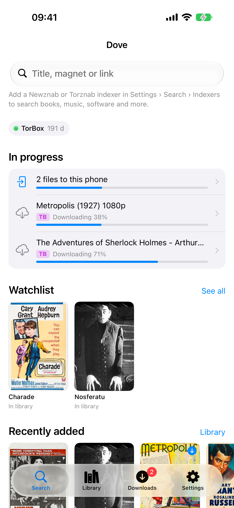
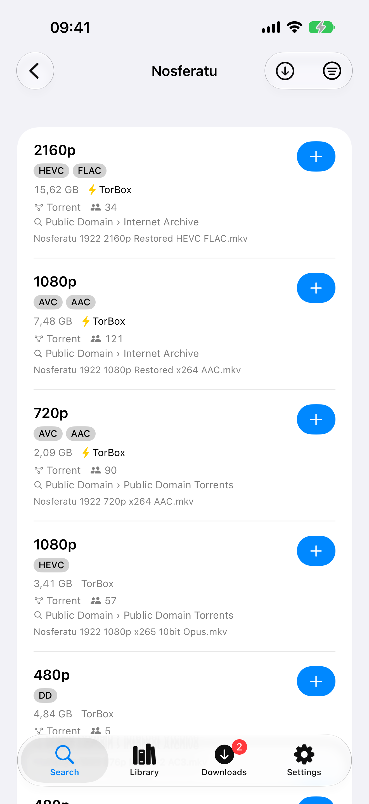
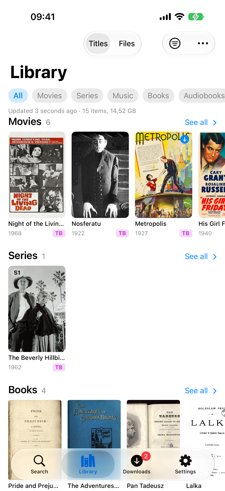
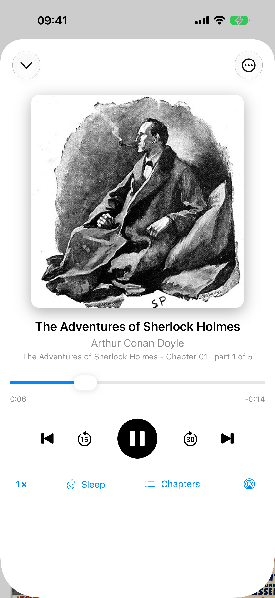
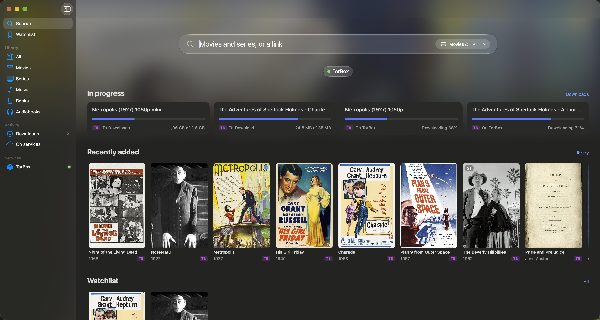

# Dove

An iOS client for debrid services and Usenet. Find a movie, a season, a book or an album; send a magnet, a `.torrent`, a hoster link or an NZB to your services; then play it in Infuse (or another player), listen to it in Dove, or download it to the phone.

> Bring your own services: Dove ships with no content sources. You add your own API keys, Stremio addons and indexers.

## Screenshots

<p>
  
  
  
  
</p>



Everything shown is public domain (films, LibriVox audiobooks, Wolne Lektury books, Musopen recordings) with
posters from Wikimedia Commons, served by Dove's demo mode: no accounts or keys involved. `scripts/screenshots.sh`
regenerates every image in [docs/screenshots](docs/screenshots).

## Services

| Source | Services | Playback |
|---|---|---|
| 🧲 Torrents: magnet, info hash, `.torrent` link or file | Real-Debrid, TorBox, Offcloud, Debrid-Link, Premiumize, AllDebrid | WebDAV/stream links in Infuse, VLC, Outplayer, SenPlayer, nPlayer, VidHub, Kodi or a custom URL template |
| 🔗 Hoster links | the same debrid services (only those that unlock the site) | or download to the phone |
| 📰 NZB link or file | nzbdav / InfiniDysk (SABnzbd API + WebDAV); TorBox, Offcloud, Premiumize with Usenet | |

- **Priority with fallback.** You order your debrids (and separately your Usenet services). "Automatic" tries them in that order and falls through to the next one on any error. Hoster links skip services that do not list the site, have it down, or used up today's quota.
- **Private trackers.** Torrents from private trackers go only to services that seed (Debrid-Link, TorBox on a paid plan). A private release that one of your services already has cached goes there as a bare magnet instead: nothing is downloaded and your ratio does not move.
- **Account status.** Online/offline lights and premium days left for every service, on the home screen, in Settings and in widgets.
- **Speed test.** Measures each service from your phone and can reorder the priority list by speed.

## Finding things

- **Movies & TV.** Search through TMDB (your key) or a Stremio addon (AIOMetadata, Cinemeta…). Title screens show seasons and episodes, then the sources for an episode, a whole season (season packs) or the whole series.
- **Sources.** From your Stremio addons (AIOStreams, with its Search API when you give it your password, Torrentio…) and Dove's own Newznab/Torznab indexers (Jackett, Prowlarr, Usenet indexers), searched from the phone in parallel. Each row is one release merged across services and trackers, with:
  - its traits: resolution, source, codec, HDR/DV, audio, languages, size;
  - which of your services have it cached (⚡);
  - where it came from (addon › tracker), whether the tracker is private, seeders and age;
  - warnings: AV1 or TrueHD Atmos on Apple TV, a name Real-Debrid refuses, a pack that looks incomplete.
- **Ranking.** "Recommended" puts what plays well on Apple TV first, then what is ready (cached or Usenet), then quality. Filters cover resolution, source, codec, HDR, audio, language, cached on, private or public, tracker, and "found by"; sorting by size, seeders or age is also there.
- **Other categories.** Books, audiobooks, music, software and adult content, searched by name through your indexers (adult is hidden unless you turn it on).
- **Smart field and share sheet.** Paste or share one link, a magnet or several at once, or a text with magnets in it. `.torrent` and `.nzb` files open in Dove too.
- **Title links.** Share or paste a movie's or series' page from IMDb, TMDB, Apple TV (including Spotlight's movie cards), Letterboxd, Trakt, Rotten Tomatoes or JustWatch: Dove opens that title with its sources.

## Library

- **One library for all services.** Every service's items in one list, shown as titles with posters (matched through TMDB or your addon; you can fix a wrong match) or as raw files. Filters cover service, kind, status and text. The library starts from a cache and refreshes behind it.
- **Content kinds.** Each item is filed as video, music, books, audiobooks, software, adult or other, from its files and name. You can change the kind by hand.
- **Series screen.** Seasons and episodes, each matched to the right file, even inside packs:
  - "All 9 episodes" or "Missing E04, E07" per season;
  - play a season, the whole series or "from here" as one Infuse playlist;
  - pick between versions of an episode;
  - missing seasons and episodes open their sources directly.
- **Library review.** Dove reviews the library after each refresh:
  - *New episodes*: a show you follow aired something since you last added to it.
  - *Missing episodes*: gaps in seasons you hold part of.
  - *Could be better*: below 1080p, a CAM/HDTV/DVD source, or AV1. A tap opens only the sources that beat what you have.
- **Obfuscated names.** Items a service lists under a random name keep the readable name and title from the search they were added from.
- **Actions.** Reinsert, move or copy to another service, copy the magnet, select files on Real-Debrid, delete. Each works on one item or on a selection.
- **Files app.** Your services appear as a location in Files: browse, open (downloads on demand), delete, or drop a `.torrent`/`.nzb` into a service's folder to add it there.

## Watching, downloading, listening

- **Players.** Infuse (playlists, episode names), VLC, Outplayer, SenPlayer, nPlayer, VidHub, Kodi over JSON-RPC, or a custom URL template. NZBs are added, waited for and played in one tap.
- **Download to the phone.** Uses a background `URLSession` with pause/resume and a retry with a fresh link. Files land in On My iPhone › Dove.
- **"Download only".** Add, wait for the service, download the right files (episode, pack, movie), then delete the item from the service.
- **Notifications and Live Activity.** A notification when a download or a download-only job finishes or fails. One Live Activity shows progress on the Lock Screen and in the Dynamic Island.
- **Audiobooks in Dove.** Positions are synced between devices. Chapters come from the m4b file or one per file, with speed, a sleep timer, ±15/30 s skips, lock screen and headphone controls, AirPlay, and a mini player. Multi-file books play part after part.
- **Books.** Send the best file to Apple Books or to your Kindle (EPUB/PDF, through Mail).

## Watchlist

Save movies and series with the bookmark on a title screen, or from a search result or poster.

- **Series:** new episodes since you saved it, or the next one to air.
- **Movies:** release status from TMDB: in theaters, digital on a date, or out now.
- **Already in the library:** marked "In library". Movies stay on the list until you remove them, because added is not watched.
- **Notifications:** a local notification when a saved show gets new episodes or a movie comes out.

## iOS integration

- **Widgets.**
  - *Services*: lights and days left. The Lock Screen versions show the soonest expiry.
  - *Library*: items and size per service.
  - *Watchlist*: news first.
  - *Listening*: cover, progress and a Play button.
- **Control Center** (iOS 18): Continue Listening, Add from Clipboard.
- **Siri and Shortcuts:**
  - Add to Dove: text with links or magnets, optionally as download only;
  - Search in Dove;
  - Continue Audiobook (plays without opening Dove);
  - Open Watchlist and Open Downloads.

  Siri suggests listening and searches you do often.
- **Spotlight.** Library titles, books, watchlist entries and titles you looked at in Dove show up (with posters) and open straight in Dove; "Search in Dove" searches any text.
- **Quick Actions** on the app icon: Add from Clipboard, Search, Watchlist, Downloads and Continue Listening.
- **Background refresh.** When iOS allows it, Dove updates premium days, episode lists, watchlist dates and widgets. iOS decides when that happens, and there are no push notifications.

## macOS

Native Mac app (not Catalyst), macOS 26, sandboxed, same bundle ID and iCloud Keychain sync as iOS.

| Feature | Description |
|---|---|
| Window | Sidebar with Search, Library, Downloads, Watchlist, Services; content and detail columns |
| Sources | Table with resolution, HDR, codec, audio, size, seeders, age, found by, ⚡ per service; sortable; multi-select; Return adds (Automatic) |
| Library | Titles as adjustable grid or table; Files table with name, service, kind, status, size, added; multi-select actions |
| Downloads | Table with progress; Reveal in Finder; drag files out; Dock progress bar and badge |
| Input | Drop `.torrent`/`.nzb`/magnets on window or Dock; ⌘O; File › Add from Clipboard (⇧⌘V); Services menu "Add to Dove" |
| Menu bar | Extra with downloads, now playing, Add from Clipboard; keeps running after last window closes |
| Settings | Settings window (⌘,) with a sidebar of the same pages as the iPhone list; shared forms with iOS |
| Players | Infuse, IINA, VLC first; custom URL template; Kodi over JSON-RPC |
| Audiobooks | Same player as iOS; Now Playing and media keys work |
| Spotlight | Library titles, books, watchlist entries indexed; "Search in Dove" searches any text |
| App Intents | Add to Dove, Search in Dove, Open Watchlist, Open Downloads, Add from Clipboard |
| Finder | File Provider location in sidebar; browse, open (downloads), delete, drop `.torrent`/`.nzb` |
| Desktop widgets | Services, Library, Watchlist, Listening widgets (same as iOS) |

Ships as a notarized DMG built by:
- `scripts/build-mac.sh`
- `scripts/notarize.sh`
- `scripts/make-dmg.sh`
- `.github/workflows/release.yml`

## Settings and sync

- **Keychain only.** Keys, addons, indexers, priorities and preferences live in the Keychain. Through iCloud Keychain (end-to-end encrypted) they reach your other devices and a fresh install.
- **Export and import.** For installs iCloud Keychain does not reach, such as a sideloaded build or the Simulator, you can export the settings as a JSON file, with or without keys and passwords. Import merges: anything the file does not hold stays on the device.
- **Notifications.** Settings › Notifications shows whether iOS allows them and has a switch with a short description for each kind.

## How it fits together

```
Source (what)            Backend (where)                                   Playback (how)
──────────────           ───────────────────────────────────────────       ──────────────────────────
🧲 magnet / .torrent  →  Real-Debrid · TorBox · Offcloud · Debrid-Link  →  Infuse / VLC / Kodi / …
🔗 hoster link        →  Premiumize · AllDebrid (priority + fallback)   →  download to the phone
📰 NZB                →  nzbdav · TorBox · Offcloud · Premiumize        →  audiobooks: Dove's player
```

The source type picks the backend family; your priority order picks the service within it. App tabs: **Search** (home screen, search, sources) · **Library** · **Downloads** (on the phone and on the services) · **Settings**.

## Status

Personal project, used daily by its author. iOS feature-complete, Mac app through phase 5 (sidebar, source tables, Settings window, menu bar extra, Dock progress, drops, Services menu, Spotlight, App Intents, Finder location, desktop widgets), notarized DMG. Left before public release: onboarding wizard, the plugin-repository split, store metadata, a hardware pass over unverified features. See the roadmap in [docs/roadmap.md](docs/roadmap.md).

## Project layout

```
App/Dove/               SwiftUI app: views, AppModel, intents, widgets' snapshot, background refresh
App/DoveShare/          Share extension (links, magnets, .torrent, .nzb)
App/DoveFiles/          File Provider extension (the Files app location)
App/DoveWidgets/        Widgets, Control Center controls, the downloads Live Activity
App/Mac/                Mac app: NavigationSplitView shell, Tables, Commands, MenuBarExtra, Settings scene
App/MacFiles/           Finder location, File Provider extension
App/MacWidgets/         Desktop widgets
App/Components/         Views shared by both apps: covers, rows, badges, settings forms
App/Shared/             SwiftUI shared by the app and its extensions
App/Activity/           Types shared by the app and the widgets (Live Activity, widget intents)
Packages/DoveKit/       All logic: models, backends, routing, search, library, Keychain (unit-tested on macOS)
Packages/DoveKit/       … also builds DoveAppCore: AppModel and the feature models shared by iOS and Mac
scripts/                Release scripts (build-mac.sh, notarize.sh, make-dmg.sh)
docs/                   Roadmap, implementation record, Mac plan, plugin API
project.yml             XcodeGen spec (the .xcodeproj is generated, not committed)
```

## Building

Requirements: Xcode 16+, iOS 17+ (Control Center controls need iOS 18), macOS 26+ (Mac app), [XcodeGen](https://github.com/yonaskolb/XcodeGen).

```sh
brew install xcodegen
xcodegen generate
open Dove.xcodeproj
```

iOS app:
```sh
xcodebuild -project Dove.xcodeproj -scheme Dove -destination 'generic/platform=iOS' -allowProvisioningUpdates build
```

Mac app:
```sh
xcodebuild -project Dove.xcodeproj -scheme DoveMac -destination 'platform=macOS' -allowProvisioningUpdates build
```

Run the core tests without Xcode (⌘U in Xcode runs them too):

```sh
cd Packages/DoveKit && swift test
```

Screenshots (Debug builds launched with `-demo`: made-up public-domain library, no real Keychain, files or
services; a fresh "Dove Screenshots" simulator for the iPhone, this Mac for the Mac app):

```sh
./scripts/screenshots.sh        # or: ios, mac
```

No third-party runtime dependencies: Foundation, SwiftUI, `URLSession`, `XMLParser` and Apple's frameworks only.

## License

[Mozilla Public License 2.0](LICENSE).

Dove is a client for services you already pay for. Use it only with content you have the right to access.
